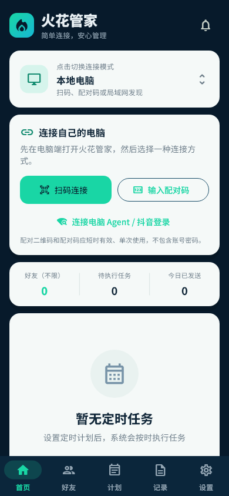
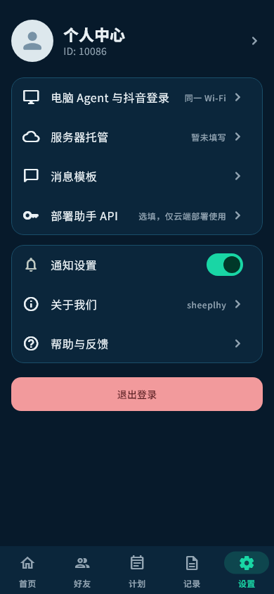
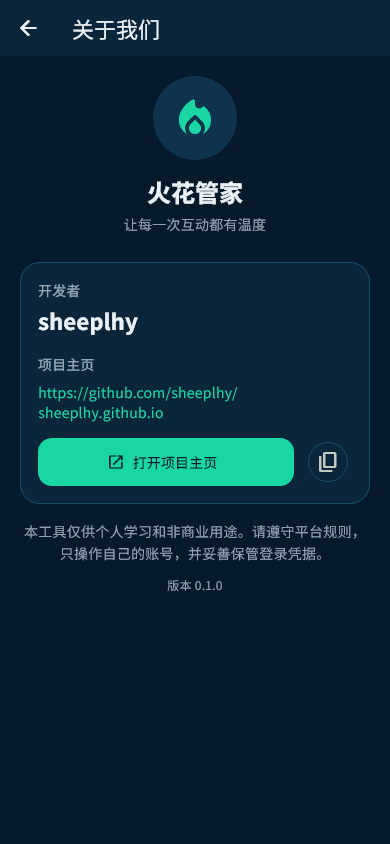

# 火花管家（Spark Keeper）

一个给个人使用的抖音好友互动管理工具。

手机端用 Flutter 编写，负责管理好友、消息和执行计划；真正的网页操作由自己的 Windows 电脑或自建服务器完成。日常使用不依赖第三方业务服务器，也不需要把抖音 Cookie 传到手机。

> 当前提供 Android 测试安装包和完整源码。测试 APK 使用调试证书签名，仅用于个人真机验收；应用商店版本需要单独保管正式签名密钥并重新构建。

## 界面

| 首页 | 设置 | 关于我们 |
| --- | --- | --- |
|  |  |  |

## 设计初衷

续火花本身是一件很简单但容易忘记的事情。我希望把“选择好友、准备消息、安排时间”放到手机里完成，同时让登录状态和网页操作留在自己的设备上。

因此项目做了两种运行方式：

- 自己的电脑：手机和电脑连接同一 Wi-Fi，电脑运行 Agent，不需要服务器，也不需要部署助手 API。
- 自建服务器：适合需要全天运行的情况，使用 Docker 部署；服务器地址暂时没有也可以先不填。

部署助手是可选功能，API 服务商、Key、接口地址和模型均由用户在 App 内自行填写。API 不写入源码，也不参与抖音登录、好友识别或消息发送。

## 已实现功能

- 在首页切换“本地电脑”和“云端服务器”模式。
- 通过地址和配对令牌连接电脑 Agent。
- 在电脑浏览器直接扫码登录，或把同一个登录二维码显示到手机。
- 登录过程中遇到验证码、设备确认或 App 授权时暂停，交给用户手动完成。
- 按准确昵称添加好友，好友数量不设产品上限，可单独暂停或删除。
- 支持随机消息、按顺序发送自定义消息，以及普通 Emoji。
- 创建定时计划并同步到电脑，关闭手机 App 后计划仍由电脑执行。
- 正式发送前提供 Dry Run，只检查登录状态和好友定位，不发送内容。
- 保存脱敏执行记录，不在手机或接口中返回 Cookie、密码和私信全文。
- 提供 Windows 安装/启动脚本和 Docker 部署配置。
- “关于我们”展示开发者 sheeplhy 和项目主页。

## 工作方式

```text
Flutter 手机 App
      │  局域网 HTTP + 配对令牌
      ▼
Windows 电脑 Agent ── Playwright ── 抖音网页版

或：

Flutter 手机 App
      │  HTTPS / 私有网络
      ▼
自建服务器 Agent ── Playwright ── 抖音网页版
```

手机只负责配置和查看状态。登录凭据、浏览器会话、定时调度和发送动作都留在执行端。

## 本地电脑运行

### 1. 安装电脑 Agent

电脑需安装 Python 3.11 或更高版本。在 PowerShell 中进入项目目录：

```powershell
cd desktop_agent
Set-ExecutionPolicy -Scope Process Bypass
.\setup-windows.ps1
.\start-agent.ps1
```

启动后窗口会显示：

- 局域网地址，例如 `http://192.168.1.20:8765`
- 随机生成的配对令牌

手机和电脑需要连接同一个可信 Wi-Fi。Windows 防火墙询问时只允许“专用网络”。

### 2. 运行 Flutter App

使用 VS Code 打开项目根目录，安装 Flutter 与 Dart 扩展，然后执行：

```powershell
flutter pub get
flutter run
```

也可以选择设备后按 `F5`。如果笔记本把 F5 当作亮度键，请使用 `Fn + F5`，或点击 VS Code 左侧的“运行和调试”。

进入 App 后：

1. 首页选择“本地电脑”。
2. 打开“连接电脑 Agent / 抖音登录”。
3. 填写电脑窗口显示的地址和令牌。
4. 测试连接后开始扫码登录。
5. 添加一个好友和一条测试消息。
6. 先运行“检查任务”，确认昵称定位正确，再执行正式发送。

Android 测试包可直接安装到手机。若系统提示“未知来源”，只对本次下载文件临时授权，安装完成后建议关闭该权限。

iOS 工程位于 `ios/`。由于 Apple 的构建和签名限制，必须在 macOS 的 Xcode 中选择自己的开发者 Team 后生成 `.ipa`，详细步骤见 `ios/README.md`。

## 服务器托管

服务器模式使用项目中的 `desktop_agent/deploy/`：

```bash
cd desktop_agent/deploy
cp .env.example .env
# 修改 .env 中的 SPARK_AGENT_TOKEN
docker compose up -d --build
```

容器默认只监听服务器的 `127.0.0.1`。外部访问需要自行配置 HTTPS 反向代理或私有 VPN/组网，不要把无 TLS 的 `8765` 端口直接暴露到公网。

部署完成后，在 App 首页选择“云端服务器”，填写 Agent 的 HTTPS 地址和 `.env` 中的令牌。服务器登录二维码会显示在手机端；验证码和设备确认仍需本人处理。

## 注意事项

- 本项目使用非官方网页自动化，不是抖音官方开放平台应用。
- 抖音网页结构变化后，好友搜索、聊天输入框或表情选择器可能需要更新。
- 自动操作存在触发平台风控或账号限制的可能，请只操作自己的账号和正常联系人。
- 首次使用只选择一个好友和一条消息，并先执行 Dry Run。
- 好友通过昵称定位。存在重名好友时必须人工确认，不要直接批量发送。
- 电脑模式要求电脑保持开机、联网并持续运行 Agent；电脑关机时计划不会执行。
- 配对令牌、`storage-state.json` 和 Cookie 都属于敏感信息，不要截图公开或提交到 Git。
- 局域网模式只适合可信网络；服务器模式必须使用 HTTPS 或私有网络。
- 验证码、安全验证和 App 授权不会被绕过，任务会暂停等待人工处理。
- 当发送结果无法确认时，程序不会自动重发，以免对同一好友重复发送。
- 页面自动化具有时效性，不能承诺长期免维护运行。

## 上游与参考

核心网页执行逻辑参考并改造自：

- [unmev/douyin-auto-fire](https://github.com/unmev/douyin-auto-fire)

该部分源码位于 `desktop_agent/engine/`，保留了上游的 `PolyForm Noncommercial License 1.0.0`：

- [上游许可证](desktop_agent/engine/LICENSE)
- [执行端说明](desktop_agent/engine/README.md)

项目同时使用 Flutter 构建手机界面，使用 Playwright 控制用户本人登录的浏览器。所有第三方依赖继续遵循各自许可证。

## 项目结构

```text
lib/                       Flutter 手机端
test/                      Flutter 自动化测试
desktop_agent/             电脑/服务器执行端
desktop_agent/engine/      抖音网页自动化核心
desktop_agent/deploy/      Docker 部署文件
docs/screenshots/          实际 Flutter 页面截图
SECURITY.md                安全说明
ACCEPTANCE.md              自动与人工验收清单
```

## 当前状态

- Flutter 静态分析通过。
- 自动化测试通过。
- Web 发布版构建通过。
- Agent 健康检查、鉴权、任务保存和计划保存通过。
- Android Release 模式测试 APK 已构建并通过 APK v2 签名校验，当前使用调试证书签名。
- iOS Xcode 工程已生成；IPA 需在 macOS/Xcode 中使用用户自己的 Apple Developer 身份签名。
- 真实抖音扫码和发送必须由账号本人在目标环境完成验收。

## 开发者

- sheeplhy
- <https://github.com/sheeplhy/sheeplhy.github.io>

本项目目前用于个人学习和非商业用途。涉及上游代码的部分以其原始许可证为准。
